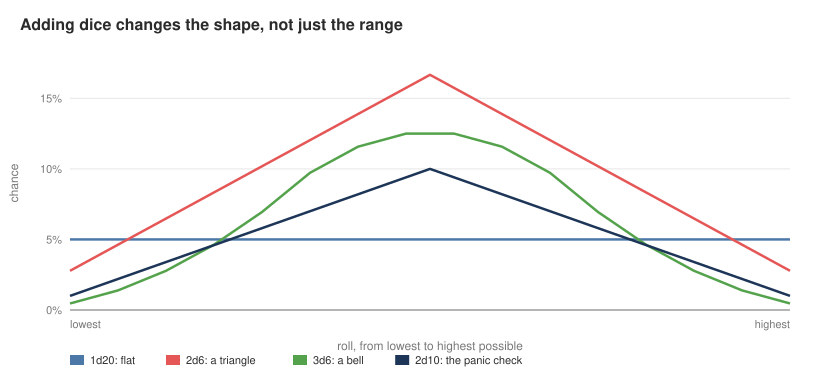
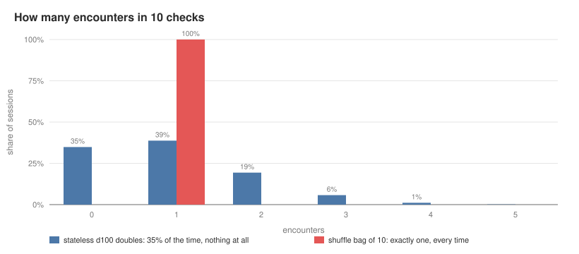
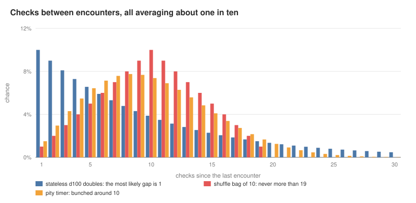
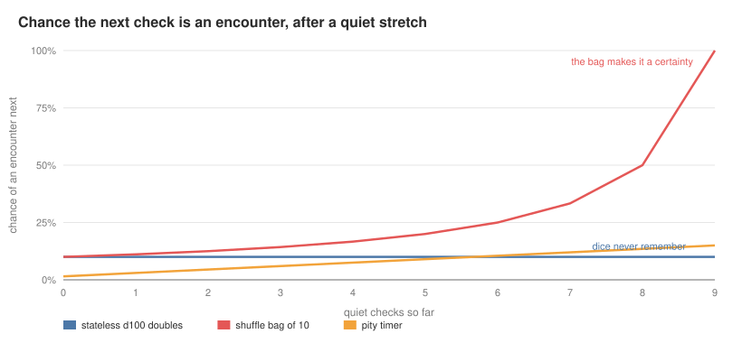
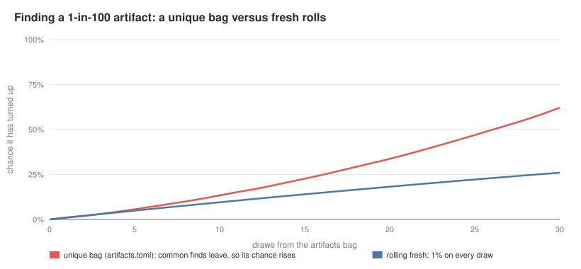
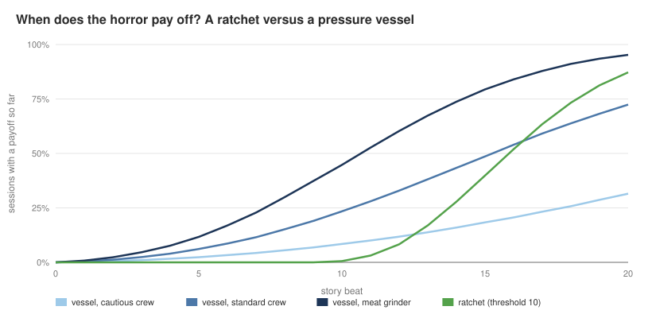
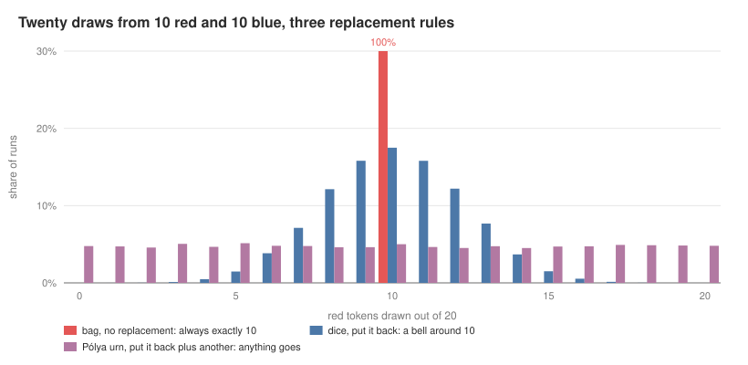
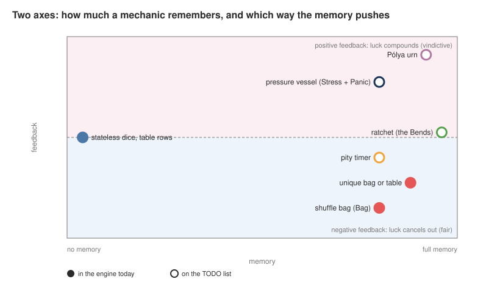

# ttrpg-engine

[](https://github.com/LorenzoPrinsloo/ttrpg-engine/actions/workflows/ci.yml)

A terminal table roller for running [Mothership](https://www.mothershiprpg.com/) as the Warden. You describe weighted **bags** and ranged **tables** in TOML files, then draw from them in an interactive shell or with one-shot commands. Entry text can include dice (`[1d10]`) and styling, and each game is saved as a named session, so the bag remembers what has already come out.

Underneath it is a small study in *kinds of randomness*: dice that forget, bags that remember, and the mechanics that horror games build on top of them. [Kinds of random](#kinds-of-random) explains each, with charts.

## Quick start

```sh
cargo run                                   # interactive shell
cargo run -- draw encounters                # draw once and exit
cargo run -- roll 2d6+3                     # roll a dice expression
cargo run -- --session derelict draw art 3  # three draws, saved in the "derelict" session
```

```text
> tables
Bags
  artifacts    100 left  unique
  encounters    10 left
Tables
  rumours        5 rows
> draw encounters
encounters: 5 Former CLOUDBANK Research Scientist(s)
```

| Command | What it does |
|---|---|
| `tables` | The bags and tables loaded, and how much is left in each |
| `draw table [n]` | Draw `n` items (default 1). Names can be abbreviated |
| `refill [table]` | Put everything back, in one table or all of them |
| `reset [table]` | Go back to how the file has it, in one table or all of them |
| `roll 2d6+3` | Roll a dice expression |
| `render markup` | Preview a markup string |
| `quit` | Leave (ctrl-D works too) |

## Bags and tables

Files live in `config/bags/` and `config/tables/`. `MOTHERSHIP_TABLES` points the program at another config directory.

**A bag** holds entries in proportion to their ratios, which add up to 1.0. It works like marbles: drawing takes a marble out until the bag is empty or refilled. With `unique = true`, drawing an entry removes every copy of it.

```toml
# config/bags/encounters.toml: 1 + 3 + 3 + 2 + 1 = 10 marbles
[[items]]
ratio = 0.1
text = '''A Diver'''

[[items]]
ratio = 0.3
text = '''[1d10] Escaped Child Android(s)'''
```

Ratios count in hundredths and are reduced by their greatest common divisor, so `0.1 / 0.3 / 0.3 / 0.2 / 0.1` becomes a bag of ten.

**A table** maps number ranges to rows, like a printed d10 or d100 table. Every draw is a fresh roll over the whole range, and a roll that lands in a gap between ranges is rolled again. With `unique = true`, each row can come up only once until the table is refilled.

```toml
# config/tables/rumours.toml: rolls 1-10
[[rows]]
range = "1-3"
text = '''The **reactor** shudders. Everyone Close takes {red|[1d5] Stress}.'''

[[rows]]
range = "10"
text = '''{bright cyan|**Something answers.**} Make a *Fear Save*.'''
```

## Markup

| Syntax | Result |
|---|---|
| `**text**`, `*text*`, `__text__` | bold, italic, underline |
| `{red\|text}` | coloured text (named colours or hex) |
| `[2d6+3]` | a dice expression, rolled when the entry is shown |
| `\x` | the next character, literally |

Anything malformed, such as an unclosed span or an unknown colour, is shown as literal text, so a typo in a file never stops the game.

## Sessions

Each game is a named session, saved after every command that changes a bag or table. `MOTHERSHIP_SESSIONS` sets where sessions are kept; by default it's your platform's data directory. If you edit a file between sessions, that bag or table starts fresh from the file, with a note. A session file that exists but can't be read stops the program, rather than being overwritten on the first draw.

## Kinds of random

### Dice forget

A d100 roll of doubles (11, 22 … 99, 00) is an encounter: 10 outcomes out of 100, so **10% per check**. That's the same odds as rolling a 1 on a d10, but it feels more dramatic at the table. Each roll is independent: the dice don't know what happened last time.

Adding dice changes the *shape* of the result, not just its range. One die is flat; two make a triangle; three make a bell:



### Bags remember

Independence makes the 10% lumpy. Over ten checks, 35% of the time there's no encounter at all, and a quarter of the time there are two or more. A *shuffle bag* fixes the rate: ten tokens, one marked "encounter", drawn without replacement and reshuffled when empty. There's exactly one encounter per ten checks; only *when* it happens is random.



Both average one encounter in ten, but the gaps between encounters differ completely. With dice, the most likely gap is one check (back-to-back encounters), and droughts can run past 30. A bag can never go more than 19 checks without one. A *pity timer* (odds that climb after every miss and reset on a hit) bunches the gaps around ten:



The cost of memory is that players can read it. After a quiet stretch, dice are still at 10%, but a bag is *due*: after nine quiet checks the next one is certain. Knowing a bag's state tells players when they're safe, so they can fire guns right after an encounter. That's why stateless dice suit horror: silence stays scary, instead of turning into bookkeeping.



This engine has both. **Tables** roll fresh every time, like dice. **Bags** remember: their state pushes outcomes back toward the ratios. A **unique bag** goes further: once something is found it's gone, so the rare entries become more likely as the common ones run out. In the artifacts bag, a 1-in-100 find has turned up in 62% of games by the 30th draw, against 26% with fresh rolls:



### Ratchets and pressure vessels

Horror games stack mechanics that remember in the other direction:

- **A ratchet** (Mothership's The Bends, clocks, radiation tracks) accumulates exposure, and consequences switch on at fixed thresholds. There's no roll between you and the payoff: it's a question of *when*, never *if*.
- **A pressure vessel** (Stress + Panic) accumulates stress too, but the payoff needs a spark: a panic check, where the roll fails if it's at or under your stress. Higher stress makes failure likelier *and* worse, and bad results add more stress, so failure feeds on itself.



The model is 20 story beats, starting at stress 2. Each beat may add stress (30%, 50% or 70% of the time, by crew) and may call a panic check (15%, 25% or 35%). A panic happens when 2d10 is at or under the current stress, and a roll of 10 or more adds stress. By the last beat, a panic has happened in 32% of cautious sessions, 72% of standard ones and 95% of meat-grinder ones. The ratchet adds exposure 60% of the time and pays off at 10. It's silent for the first half of the session, then near-certain by the end (87%).

The curves show two kinds of horror. The vessel is jump-scare logic: it could go off at any moment, and the longer it hasn't, the worse it will be. The ratchet is doom logic: nothing is wrong yet, and you know exactly why that won't last.

### One urn, three rules

Every mechanic above is an *urn*, a bag of tokens. The only difference between them is what happens to a token after it's drawn:

- **Don't put it back:** a shuffle bag. It *converges*: 20 draws from 10 red and 10 blue are always exactly 10 red.
- **Put it back:** dice. Independent, a bell around the average.
- **Put it back plus another of the same colour:** a *Pólya urn*. Rich get richer: early luck snowballs, and any split is about as likely as any other.



### Two axes

So randomness isn't a single line from stateless to stateful. One axis is *how much* a mechanic remembers. The other is *which way* that memory pushes. Bags and pity timers spend memory to make the world fair. Vessels and Pólya urns spend it to make the world vindictive. Ratchets drop the dice entirely and keep only the memory.



The filled points are what the engine does today; the rest are on the [TODO list](TODO.md).

The charts are computed exactly, or simulated with fixed seeds, by `docs/charts/generate.py` (Python 3.11+, standard library only). Where a chart shows the engine, the script follows the engine's rules. To redraw them:

```sh
python3 docs/charts/generate.py
```

## Development

```sh
cargo test                 # unit tests, property tests and end-to-end tests of the binary
cargo clippy --all-targets
cargo fmt --check
```

Besides unit and end-to-end tests, [proptest](https://proptest-rs.github.io/proptest/) property tests check the randomness, among other things:
- Bags hold their ratios and give back every marble when drawn empty.
- Unique bags and tables never repeat before a refill.
- Tables draw rows in proportion to their width.
- Dice always roll within their bounds.
- Any text at all parses as markup without crashing.

CI runs all three commands on every push. Coding conventions are in [CLAUDE.md](CLAUDE.md).

## Licence

[GPL-3.0](LICENSE)
