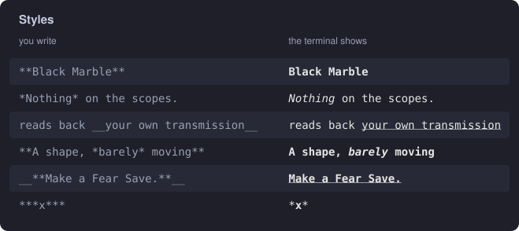
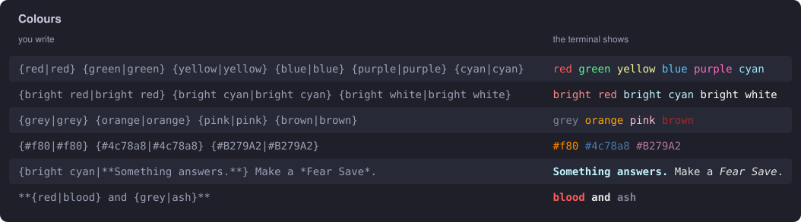
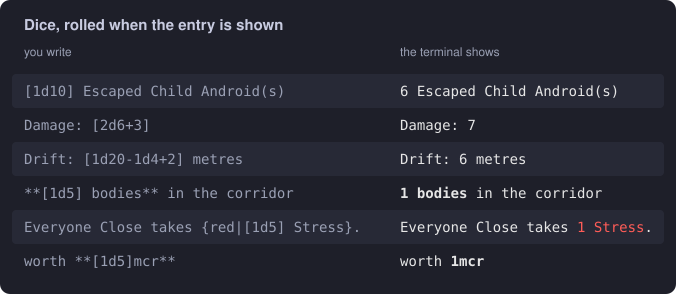
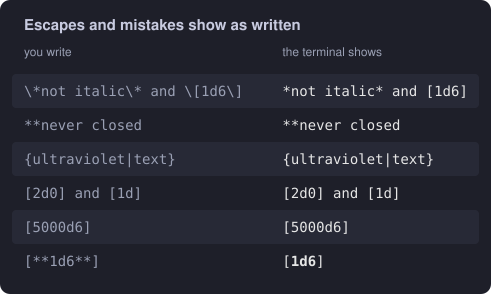

# Markup

Entry text in bags and tables is written in a small markup language. It adds styling, colour and dice rolls, and the shell renders it with terminal colours. Every picture on this page is real output from the `render` command, which you can use to try anything out:

```sh
cargo run -- render '{red|**[1d5] Stress**}'
```

| You write | You get |
|---|---|
| `**text**` | bold |
| `*text*` | italic |
| `__text__` | underline |
| `{colour\|text}` | coloured text |
| `[2d6+3]` | a dice expression, rolled each time the entry is shown |
| `\x` | the character `x` itself, with no special meaning |

## Styles



- Styles can be nested inside each other in any order: `**A shape, *barely* moving**`.
- Spans can't overlap, and a style can't be nested inside itself. In `**a **b** c**`, the second `**` closes the first span.
- Where bold and italic could both match, bold wins. So `**a *b* c**` and `*a **b** c*` both nest, while `***x***` takes the inner `**` pair and leaves the outer asterisks as text.

## Colours



`{colour|text}` colours everything up to the closing `}`. The first `|` separates the colour from the text, so the text itself can contain more `|`.

| Colour names | |
|---|---|
| Terminal colours | `black`, `red`, `green`, `yellow`, `blue`, `magenta` (or `purple`), `cyan`, `white` |
| Bright versions | `bright red`, `bright cyan`, and so on |
| Extra names | `grey` (or `gray`), `orange`, `pink`, `brown` |
| Hex | `#rgb` or `#rrggbb`, such as `#f80` or `#4c78a8` |

Names are case-insensitive. Styles and colours combine in either order: `{bright cyan|**Something answers.**}` and `**{red|blood}**` both work.

## Dice



Square brackets hold a dice expression: dice (`1d10`, `2d6`) and whole numbers, added or subtracted (`1d20-1d4+2`). It's rolled every time the entry is drawn, so the same entry reads differently each time. The result takes on the style around it: `{red|[1d5] Stress}` rolls a red number.

An expression can have at most 1,000 dice of at most 1,000,000 sides each, so a typo can't hang the game. A total can go below zero when a term is subtracted.

## Escapes and mistakes



- **Escapes:** put `\` before a character to show it as itself: `\*`, `\[`, `\{`, `\\`.
- **Mistakes:** anything that isn't valid is shown as written: an unclosed span, an unknown colour, or a bad dice expression. A typo in a file never stops the game; you'll just see the raw text.
- **Brackets that aren't dice:** these are ordinary text, so markup inside them still applies. `[**1d6**]` shows a bold `1d6` between plain brackets, not a roll.

## Writing markup in TOML

Use `'''` quotes for entry text. TOML does no escaping inside them, so backslashes and quotes reach the markup exactly as you typed them:

```toml
[[items]]
ratio = 0.19
text = '''**[1d10] Black Marble(s).** Undiscovered material. Indestructible. **10kcr each.**'''

[[rows]]
range = "10"
text = '''{bright cyan|**Something answers.**} Make a *Fear Save*.'''
```

These images are drawn by `docs/charts/markup.py`, which runs each example through the real binary. To redraw them, run `cargo build` and then `python3 docs/charts/markup.py`.
